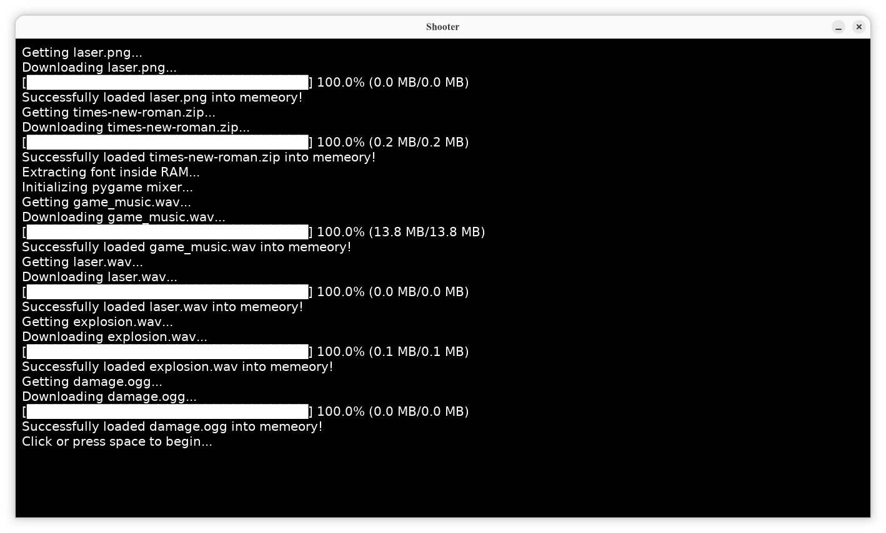
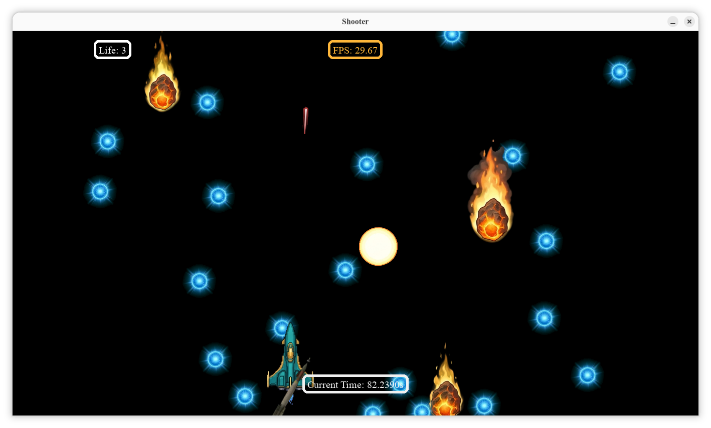
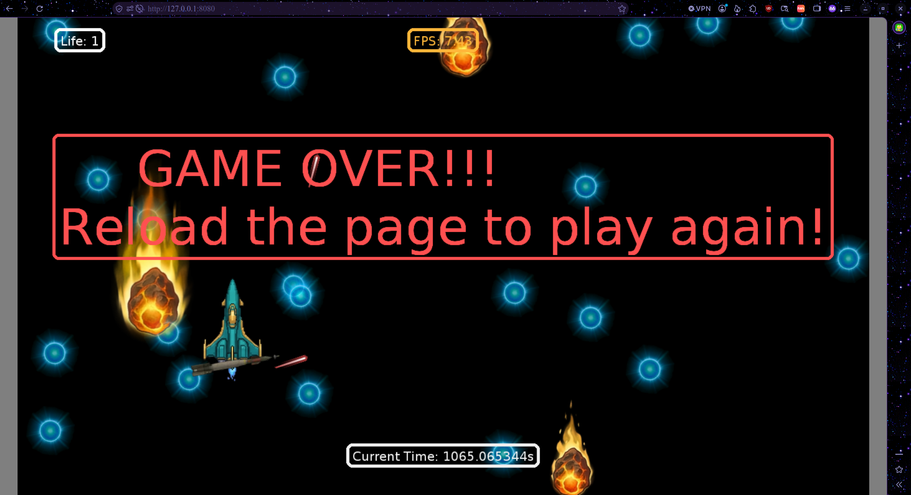

This is a space shooter game created using pygame. This game can only be played on a device that accepts mouse and keyboard inputs for now.
The full game is still in development but a demo is out to try at https://festy-ay.github.io/Space-shooter/ !

The controls include the WASD keys and arrow keys for movement, space or left click to shoot lasers.

## Game Resources
For image resources like the Spaceship, Meteor, Sun and Orb, they were google searched, screenshot from the search page and processed with AI to get the achieved result. Due to licenses and cost of the images, I had to screenshot them online and prompt Gemmini to generate a similar photo, but since I use the free version of Gemmini it couldn't generate images with transparent pixels and neither could it generate frame by fram photos and gave me a spritesheet instead. I prompted claude and it created a website that divides the spritesheet and after divididing it I then used https://www.remove.bg/ and https://www.photoroom.com/tools/background-remover to remove the background of each image before I am able to use them in the game. There are some images that gemmini couldn't generate a new one for me and I had to use the screenshoted format that way, slice it and remove the background.
The website generated by claude is provided in "/Frame%20Slicer/Frame%20Slicer.html"
Other image resources are loaded during runtime due to no license provided from the source
They include: https://github.com/clear-code-projects/5games/blob/refs/heads/main/space%20shooter/images/laser.png

For sound resources, they are all loaded during runtime also due to no licens provided by the source.
They include all sound files found in: https://github.com/clear-code-projects/5games/tree/refs/heads/main/space%20shooter/audio

There are two fonts used in the game of which one has an open source license (see /Font/LICENSE), the other font used (Times New Romans) is loaded and unzipped during runtime from https://font.download/dl/font/times-new-roman.zip, if dowload fails, it defaults back to DejaVuSans.

Some of the code used in this project are AI generated using claude.ai and google.com/ai then heavily modified by me to get working in the game.

## Demo

The files used to create the demo had to be seperate from the main game's file as they use different protocols to download resources online.
As a result, the Demo files are provided at "/Demo/" 
The Demo was created using pygbag and pushed to guthub for general public.
To see how the demo differs from the main game check the main.py files for the main game and the demo.
Also compare func.py to demo_fun.py.
Most of the code used in the demo are AI generated and modifed for use cases.

You can make your reseach to know how to use pygbag and modify your code for it's use case.
I particularly had problems creating the demo as I didn't know how to use pygbag and my code kept failing only in the browser.
One thing that can help there is; instead of using http://localhost:port, use http://127.0.0.1:port (change port to the port you are hosting it on your PC)
Also ensure to add 'await asyncio.sleep(0)' to ANY while loop in your code.
It prevents the browser from crashing and don't let your window be opened for too long without calling pygame.event.get()

## Credits
I am a learner in pygame but not entirely new to python.
This is my first pygame project and it was made possible through tutorials form Clear Code on YouTube: https://youtu.be/8OMghdHP-zs?si=DRn-YNZAkx4_Klh7
Credits to clear code and credits to Hack Club for hosting terra.