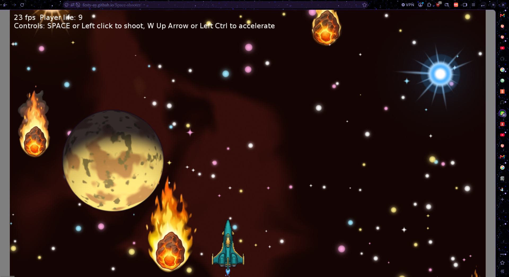

This is a space shooter game created using pygame. This game can only be played on a device that accepts mouse and keyboard inputs.
The full game is now completed and the demo is yet to be updated, to try the current demo: https://festy-ay.github.io/Space-shooter/ !

The controls include:
    -Cursor position for horizontal position of the spcaeship
    -Space or left click to shoot laser
    -Left Ctrl, W key, Up Arrow Key or Right Click to accelerate

## Game Resources
For image resources like the Spaceship, Meteor, Sun and Orb, they were google searched, screenshot from the search page and processed with AI to get the achieved result. Due to licenses and cost of the images, I had to screenshot them online and prompt Gemmini to generate a similar photo, but since I use the free version of Gemmini it couldn't generate images with transparent pixels and neither could it generate frame by fram photos and gave me a spritesheet instead. I prompted claude and it created a website that divides the spritesheet and after divididing it I then used https://www.remove.bg/ and https://www.photoroom.com/tools/background-remover to remove the background of each image before I am able to use them in the game. There are some images that gemmini couldn't generate a new one for me and I had to use the screenshoted format that way, slice it and remove the background.
The website generated by claude is provided in 
Other image resources are loaded during runtime due to no license provided from the source
They include: https://github.com/clear-code-projects/5games/blob/refs/heads/main/space%20shooter/images/laser.png

For sound resources, they are all loaded during runtime also due to no licens provided by the source.
They include all sound files found in: https://github.com/clear-code-projects/5games/tree/refs/heads/main/space%20shooter/audio

There are two fonts used in the game of which one has an open source license (see /Font/LICENSE), the other font used (Times New Romans) is loaded and unzipped during runtime from https://font.download/dl/font/times-new-roman.zip, if dowload fails, it defaults back to DejaVuSans.

Some of the code used in this project are AI generated using claude.ai and google.com/ai then heavily modified by me to get working in the game.

The background used in the game is written in GLSL shader language (see ). It is AI generated using Claude AI and modified to fit the game. In  moderngl was used to render it as a background for the game and for displaying sprites and other elements of the game, and overlay had to be created for other things to be drawn on.

For more info on the shader, [see my chat with Claude](https://claude.ai/share/d2a5e625-3a61-4e1f-a789-8899c3d718e4) or browse online for more resources.
And plese do not that I have limited knowledge on bias and content sharing online so a comment telling me about anything I shared or said that isn't meant to be so would help 🙏

## Demo

The files used to create the demo had to be seperate from the main game's file as they use different protocols to download resources online.
As a result, the Demo files are provided at 
The Demo was created using pygbag and pushed to guthub for general public.
For more info on how pygbag works and the library that broke my main game logic forcing me to write an exclusive logic for the demo, [see my chat with Claude](https://claude.ai/share/9b2bacaf-fcfe-47ca-bc5d-cba434f19b72)
To see how the demo differs from the main game check the main.py files for the main game and the demo.
Also compare  to .
Most of the code used in the demo are AI generated and modifed for use cases.

You can make your reseach to know how to use pygbag and modify your code for it's use case.
I particularly had problems creating the demo as I didn't know how to use pygbag and my code kept failing only in the browser.
One thing that can help there is; instead of using http://localhost:port, use http://127.0.0.1:port (change port to the port you are hosting it on your PC)
Also ensure to add 'await asyncio.sleep(0)' to ANY while loop in your code.
It prevents the browser from crashing and don't let your window be opened for too long without calling pygame.event.get()

## Features
The game can now run in a maximised window and can be adjusted at runtime, the cursor was also changed to use your system's crosshair cursor

The game only counts high scores across replays of the same gaming session and not across different gaming sessions.

There is also a healing orb that nearly resembles a blue star from the bacj=kground shader but is animated. It adds one health to thr player and the layer can only have maximum of 5 health.

There is also difficulties attached to the game starting from 0 and max of 9

## Credits
I am a learner in pygame but not entirely new to python.
This is my first pygame project and it was made possible through tutorials form Clear Code on YouTube: https://youtu.be/8OMghdHP-zs?si=DRn-YNZAkx4_Klh7
Credits to clear code and credits to Hack Club for hosting terra.