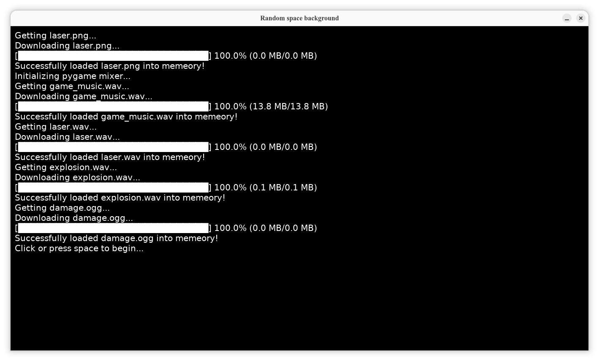
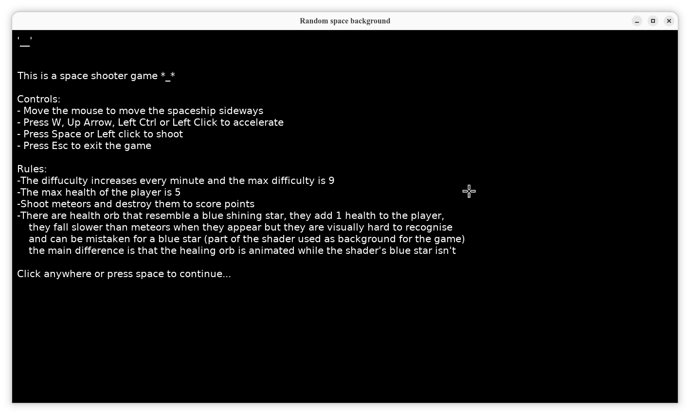
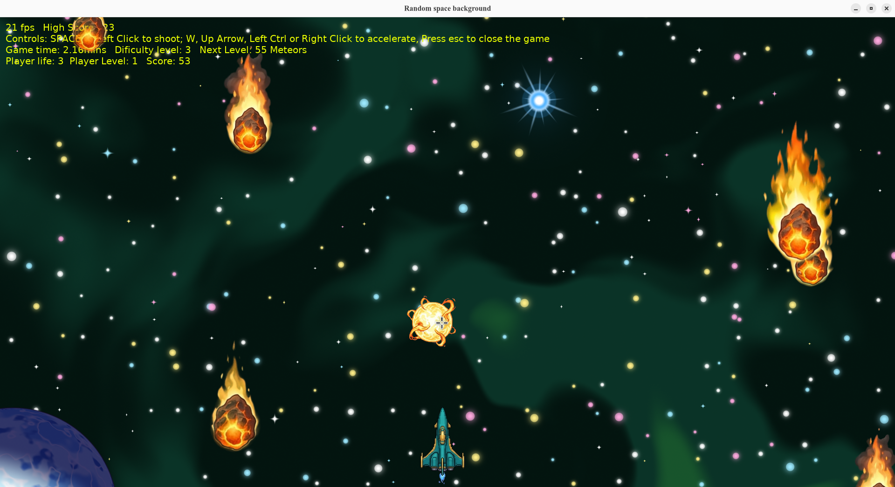
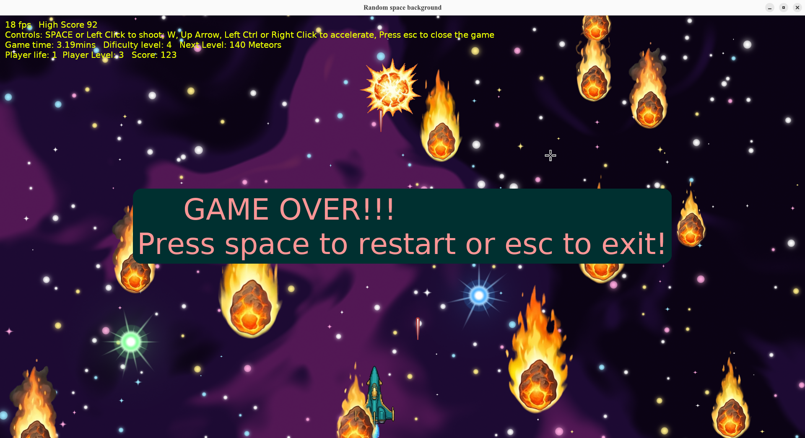
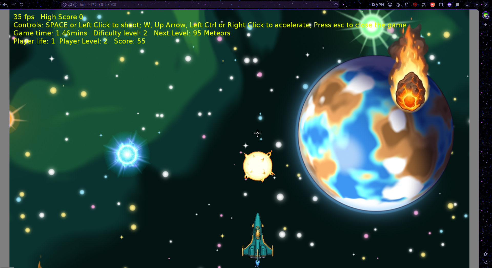
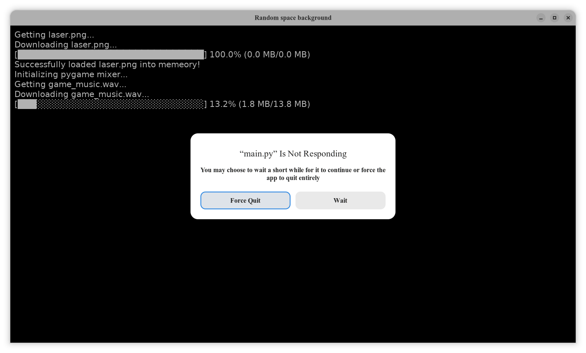

This is a space shooter game created using pygame. This game can only be played on a device that accepts mouse and keyboard inputs.
The full game is now completed and the demo is available to try [here](https://festy-ay.github.io/Space-shooter/) !.

The controls include:
    -Cursor position for horizontal position of the spcaeship
    -Space or left click to shoot laser
    -Left Ctrl, W key, Up Arrow Key or Right Click to accelerate

## Download

Grab the latest game build from the **[Releases Page](../../releases/latest)**.
Or play the online demo [here](https://festy-ay.github.io/Space-shooter/)

## Game Resources
For image resources like the Spaceship, Meteor, Sun and Orb, they were google searched, screenshot from the search page and processed with AI to get the achieved result. Due to licenses and cost of the images, I had to screenshot them online and prompt Gemmini to generate a similar photo, but since I use the free version of Gemmini it couldn't generate images with transparent pixels and neither could it generate frame by frame photos and gave me a spritesheet instead. I prompted claude and it created a website that divides the spritesheet and after divididing it I then used https://www.remove.bg/ and https://www.photoroom.com/tools/background-remover to remove the background of each image before I was able to use them in the game. There are some images that gemmini couldn't generate a new one for me and I had to use the screenshoted format that way, slice it and remove the background.
The website generated by claude is provided [here](/Frame%20Slicer/Frame%20Slicer.html)
Other image resources are downloaded during runtime due to no license provided from the source.
They include: [The laser photo](https://github.com/clear-code-projects/5games/blob/refs/heads/main/space%20shooter/images/laser.png)

For sound resources, they are all loaded during runtime also due to no licens provided by the source.
They include all sound files found in: https://github.com/clear-code-projects/5games/tree/refs/heads/main/space%20shooter/audio

The font used in the game is open source (see [DejaVuFont License](/Main/Font/LICENSE)), it's the same font used in both the main and demo build.

Some of the code used in this project are AI generated using [Claude AI](claude.ai) and [Google AI Mode](google.com/ai) then heavily modified by me to get working in the game.

The background used in the game is written in GLSL shader language (see [here](Main/Shader/space_bg_blend.frag)). It is AI generated using Claude AI and modified to fit the game. In [main.py](/Main/main.py) moderngl was used to render it as a background for the game and as for displaying sprites and other elements of the game, an overlay had to be created for other things to be drawn on.

For more info on the shader, [see my chat with Claude](https://claude.ai/share/d2a5e625-3a61-4e1f-a789-8899c3d718e4) or browse online for more resources.
And plese do not that I have limited knowledge on bias and content sharing online so a comment telling me about anything I shared or said that isn't meant to be so would help 🙏

## Demo

The files used to create the demo had to be seperate from the main game's file as they use different protocols to download resources online.
As a result, the Demo files are provided at /Demo/
The Demo was created using pygbag and pushed to guthub for general public.
For more info on how pygbag works and the library that broke my main game logic forcing me to write an exclusive logic for the demo, [see my chat with Claude](https://claude.ai/share/9b2bacaf-fcfe-47ca-bc5d-cba434f19b72)
To see how the demo differs from the main game check the main.py files for the [main game](/Main/main.py) and the [demo](/Demo/main.py).
Also compare Main/code/func.py to /Demo/code/func.py.
Most of the code used in the demo are AI generated and modifed for use cases.
You can make your reseach to know how to use pygbag and modify your code for it's use case.
I particularly had problems creating the demo as I didn't know how to use pygbag and my code kept failing only in the browser.
One thing that can help there is; instead of using http://localhost:port, use http://127.0.0.1:port (change port to the port you are hosting it on your PC)
Also ensure to add 'await asyncio.sleep(0)' to ANY while loop in your code.
It prevents the browser from crashing and don't let your window be opened for too long without calling pygame.event.get()

As for the background of the demo, I made four long scrollable photos of the shader used for the main game, AI help a lot here. Since moderngl isn't compatible with pygbag to run on the web and there would be issues running GLSL on the web, four repeatable and scrollable photo frames of the shader were created and a random one is selected when the game starts and when you restart the game after losing.
The files are [here](/Demo/Shader%20Gif%20Tiles/)

## Features and Rules
The desktop version of the game can now run in a maximised window and can be adjusted at runtime, the cursor was also changed to use your system's crosshair cursor for both the desktop and demo versions.

The game only counts high scores across replays of the same gaming session and not across different gaming sessions.

There is also a healing orb that nearly resembles a blue star from the background shader but is animated. It adds one health to the player and the player can only have maximum of 5 health.

There is also difficulties attached to the game starting from 0 and max of 9, along side player level that is determined by how many meteors have been destroyed since the beginning of the gaming session. As the player level increases, the laser cooldown time reduces and the laser speed increases but is mostly noticable at level 5 and above. So if you start the game from difficulty level 1 and don't score points to upgrade the player level, it becomes very hard once you reach difficulty level 4 or 5 as the difficulty level increases every minute regardless of the player's level!.

As for collisions in the game, the game uses pygame.collidesprite but since it can be hardware intensive, the function states that it would use the mask provided by the sprite if i thas on so masks were generated from certain frames of some sprites and used as the sprite mask for collision. This prevents collision with the player's exhaust fire (which isn't fully captured as the player is locked to the buttom of the display) and meteors and vise versa, so subsiquently you many notice the laser not colliding with the meteor at the edges.
see the 'mask' attribute of each sprite uder player.py and sprite.py.

## Errors

If your network is really slow and the download takes long to recieve response from the server, I couldn't find a way to call pygame.event.get()
Once your system sees unattended events on ground then it marks the window as 'Not Responding', same thing happens in the browser.
Sometimes I used to leave it alone and wait till the network responds or the attempt fails.

.png)

I even reduced the timeout from 30 to 15 seconds in the main game version and set a total of 50s download time for the web version and moved the downloading of the game_music (which is the largest) to be the last just to try to fix the problem.

On the desktop version I also noticed lower framerates and high GPU usage due to OpenGL being used as the background shader for the game.

In case of unavailable network or failed downloads a pygame surface is drawn to replace the laser (see line 91 Game.__init__() of [main.py](/Main/main.py) and line 195 Game.run() of [demo main.py](/Demo/main.py)). The game then continuse without sound resources.

## Credits
I am a learner in pygame but not entirely new to python. I am really happy to have the chance to build a game like this and am satisfied with the result.
This is my first pygame project and it was made possible through tutorials form Clear Code on YouTube: https://youtu.be/8OMghdHP-zs?si=DRn-YNZAkx4_Klh7
Credits to clear code and credits to Hack Club for hosting terra!.